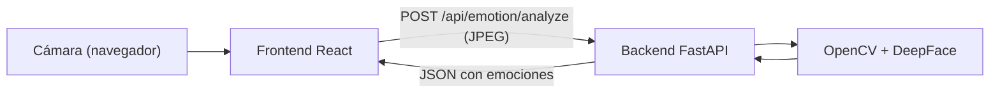

# DetectaEmociones

Aplicación web que usa la cámara del computador para detectar un rostro y estimar su expresión facial en tiempo real: feliz, triste, enojado, sorprendido, con miedo, disgustado o neutral.

- **Frontend:** React + Vite + TypeScript + Tailwind CSS. Abre la cámara en el navegador, captura fotogramas y muestra los resultados.
- **Backend:** FastAPI + OpenCV + DeepFace. Recibe cada fotograma, detecta el rostro principal y devuelve las puntuaciones del modelo preentrenado.

> Los resultados son una **estimación de la expresión facial**, no una lectura fiable del estado emocional real. Las imágenes se procesan en memoria en tu propio backend y no se guardan.

## Cómo funciona



1. El navegador abre la cámara (`getUserMedia`).
2. Cada ~850 ms captura un fotograma, lo reduce y lo envía como JPEG (sin enviar uno nuevo hasta recibir respuesta del anterior).
3. El backend lo decodifica con OpenCV y DeepFace estima las 7 expresiones del rostro principal.
4. El frontend muestra la expresión predominante, las barras de puntuación y el recuadro sobre el rostro.

## Estructura

```text
DetectaEmociones/
├── backend/    # API FastAPI (ver backend/README.md)
├── frontend/   # Interfaz React (ver frontend/README.md)
└── README.md
```

## Requisitos

- Windows 10/11 (también funciona en Linux/macOS)
- Python 3.10 o 3.11
- Node.js 18 o superior
- Una cámara web y conexión a internet la primera vez (DeepFace descarga los pesos del modelo)

## Ejecutar el proyecto

Abre **dos terminales** (PowerShell).

**Terminal 1: backend**

```powershell
cd DetectaEmociones\backend
npm install      # solo la primera vez, instala las dependencias de Python
Copy-Item .env.example .env   # solo la primera vez
npm run dev
```

**Terminal 2: frontend**

```powershell
cd DetectaEmociones\frontend
npm install      # solo la primera vez
Copy-Item .env.example .env   # solo la primera vez
npm run dev
```

Abre <http://localhost:5173>, pulsa **Activar cámara** y acepta el permiso del navegador.

| Servicio | URL |
| :--- | :--- |
| Frontend | <http://localhost:5173> |
| Backend | <http://localhost:8000> |
| Documentación de la API (Swagger) | <http://localhost:8000/docs> |

> La primera ejecución puede tardar unos segundos extra mientras DeepFace descarga y carga el modelo.

## Problemas comunes

| Problema | Solución |
| :--- | :--- |
| "API sin conexión" en la barra superior | Comprueba que el backend esté corriendo en el puerto 8000 y que `VITE_API_BASE_URL` en `frontend/.env` apunte a él. |
| Permiso de cámara bloqueado | Permite la cámara desde el icono junto a la URL del navegador y pulsa "Reintentar acceso". |
| Cámara en uso | Cierra Zoom, Teams u otra app que la esté usando. |
| Error `DLL load failed` al importar TensorFlow | Instala el [Visual C++ Redistributable x64](https://learn.microsoft.com/es-es/cpp/windows/latest-supported-vc-redist). |

## Licencias

Las dependencias principales (FastAPI, React, Vite, Tailwind, OpenCV, TensorFlow, DeepFace) usan licencias libres (MIT / Apache 2.0 / BSD). El modelo `Emotion` viene incluido en [DeepFace](https://github.com/serengil/deepface) (MIT).
